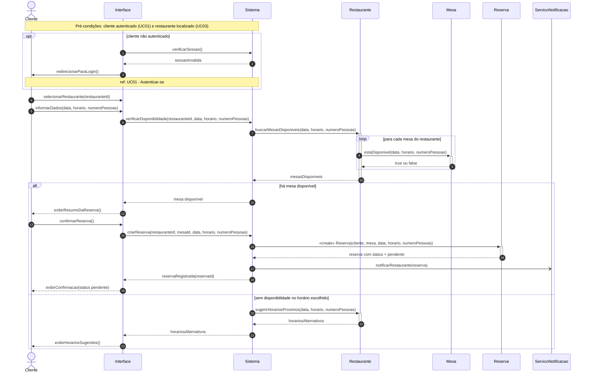

# Diagrama de Sequência 1 — Reservar mesa (UC04)

## 1. Contexto

| Item | Descrição |
|---|---|
| **Caso de uso** | UC04 — Reservar mesa |
| **Ator principal** | Cliente |
| **Pré-condições** | Cliente autenticado (UC01) e restaurante já localizado na busca (UC03) |
| **Pós-condição** | Reserva criada com status `pendente`, aguardando confirmação do restaurante (UC09) |
| **Fluxo alternativo coberto** | Sem disponibilidade no horário escolhido; cliente não autenticado |

## 2. Linhas de vida

| Linha de vida | Papel | Origem |
|---|---|---|
| `Cliente` | Ator | Ator do UC04 |
| `Interface` | Fronteira (tela web) | Camada de apresentação |
| `Sistema` | Controlador que orquestra o caso de uso | Camada de controle |
| `Restaurante` | Classe de domínio | TG3 |
| `Mesa` | Classe de domínio | TG3 |
| `Reserva` | Classe de domínio | TG3 |
| `ServicoNotificacao` | Serviço de apoio (não é classe de domínio) | Infraestrutura |

## 3. Diagrama

## 4. Explicação

O diagrama segue o fluxo principal do UC04 e os dois fluxos alternativos descritos na especificação.

**Autenticação (fluxo alternativo).** Antes de qualquer coisa, a interface consulta o sistema para saber se há sessão válida. Se não houver, o cliente é redirecionado para o login, que está detalhado no UC01 e por isso aparece apenas como referência (`ref`), sem repetir os passos.

**Consulta de disponibilidade.** O cliente escolhe o restaurante e informa data, horário e número de pessoas. O `Sistema` pede ao `Restaurante` as mesas disponíveis, e o restaurante pergunta a cada `Mesa` (laço `loop`) se ela atende aos parâmetros. Isso usa os atributos `capacidade` e `horariosDisponiveis` da classe `Mesa` do TG3.

**Com disponibilidade (fluxo principal).** O sistema mostra o resumo da reserva e o cliente confirma. O `Sistema` cria o objeto `Reserva` (mensagem `«create»`), que nasce com `status = pendente`, conforme o enum `StatusReserva`. Em seguida, o restaurante é notificado de forma assíncrona (seta aberta `-)`), porque o cliente não precisa esperar o envio da notificação para ver a confirmação na tela.

**Sem disponibilidade (fluxo alternativo).** Se nenhuma mesa atende ao pedido, o `Sistema` pede ao `Restaurante` horários próximos com mesas livres e a interface os apresenta ao cliente.

## 5. Decisões de modelagem

- `Interface` e `Sistema` não existem no diagrama de classes de domínio (TG3), pois são elementos de apresentação e controle. Foram incluídos para mostrar quem orquestra a interação sem poluir o modelo de domínio.
- `ServicoNotificacao` também fica fora do domínio: representa o mecanismo que envia o aviso (e-mail, push etc.), cuja escolha é decisão de implementação.
- A consulta às mesas passa pelo `Restaurante`, e não direto pelo `Sistema`, porque a composição `Restaurante` → `Mesa` do TG3 indica que o restaurante é o dono das suas mesas.
