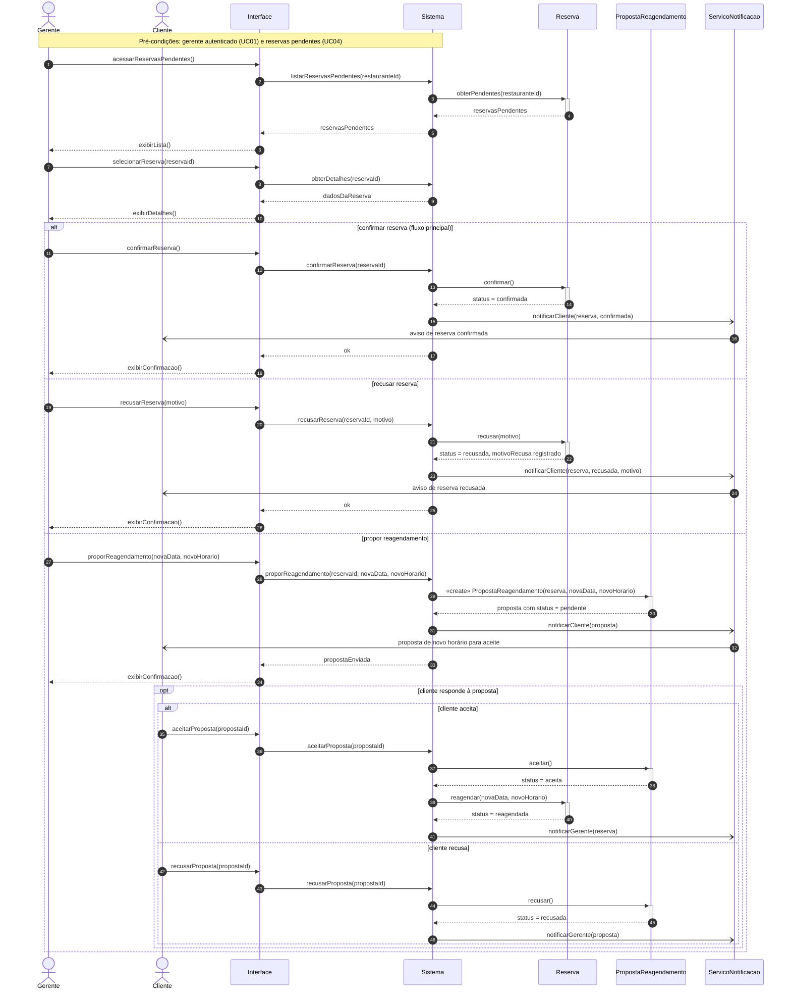

# Diagrama de Sequência 2 — Gerenciar reservas recebidas (UC09)

## 1. Contexto

| Item | Descrição |
|---|---|
| **Caso de uso** | UC09 — Gerenciar reservas recebidas |
| **Ator principal** | Gerente do Restaurante |
| **Pré-condições** | Gerente autenticado (UC01) e existência de reservas pendentes (UC04) |
| **Pós-condição** | Reserva com status definido (`confirmada`, `recusada` ou `reagendada`) e cliente notificado |
| **Fluxos alternativos cobertos** | Recusar reserva (com motivo); propor reagendamento |

## 2. Linhas de vida

| Linha de vida | Papel | Origem |
|---|---|---|
| `Gerente` | Ator | Ator do UC09 |
| `Cliente` | Ator secundário (recebe notificações e responde à proposta) | Ator do UC04 |
| `Interface` | Fronteira (tela web) | Camada de apresentação |
| `Sistema` | Controlador que orquestra o caso de uso | Camada de controle |
| `Reserva` | Classe de domínio | TG3 |
| `PropostaReagendamento` | Classe de domínio | TG3 |
| `ServicoNotificacao` | Serviço de apoio (não é classe de domínio) | Infraestrutura |

## 3. Diagrama

## 4. Explicação

**Listagem e escolha da reserva.** O gerente acessa a lista de reservas pendentes do seu restaurante, escolhe uma e vê os detalhes. Essa etapa é comum aos três desfechos, por isso fica antes do bloco `alt`.

**Confirmar (fluxo principal).** O `Sistema` manda a `Reserva` se confirmar, e ela passa a `status = confirmada`. O cliente é avisado por meio do `ServicoNotificacao`.

**Recusar (fluxo alternativo).** O gerente precisa informar um motivo. A `Reserva` passa a `status = recusada` e guarda o texto no atributo `motivoRecusa`, que existe na classe `Reserva` do TG3. O cliente recebe a notificação com o motivo.

**Propor reagendamento (fluxo alternativo).** Em vez de alterar a reserva diretamente, o sistema cria um objeto `PropostaReagendamento` com `status = pendente`, ligado à reserva (associação 1 para 0..1 do TG3), e o envia ao cliente para aceite. A reserva só muda de situação depois da resposta dele:

- se o cliente **aceita**, a proposta vira `aceita` e a `Reserva` passa a `reagendada`, com a nova data e o novo horário;
- se o cliente **recusa**, a proposta vira `recusada`.

O bloco `opt` indica que a resposta do cliente pode acontecer depois, em outro momento, e não necessariamente na mesma sessão do gerente.

## 5. Decisões de modelagem e pontos em aberto

- Todas as notificações são assíncronas (`-)`), pois o gerente não precisa esperar o envio para continuar o trabalho.
- A especificação do UC09 diz que o sistema "envia a proposta ao cliente para aceite", mas não detalha a resposta do cliente. Modelamos esse trecho dentro de `opt` para deixar claro o caminho que leva ao status `reagendada` previsto na pós-condição do caso de uso.
- **Ponto em aberto:** a especificação não diz o que acontece com a reserva se o cliente recusar a proposta. No diagrama, apenas a proposta muda para `recusada` e a reserva permanece como está. Essa regra pode ser refinada nas próximas entregas (diagrama de transição de estado, TG6).
