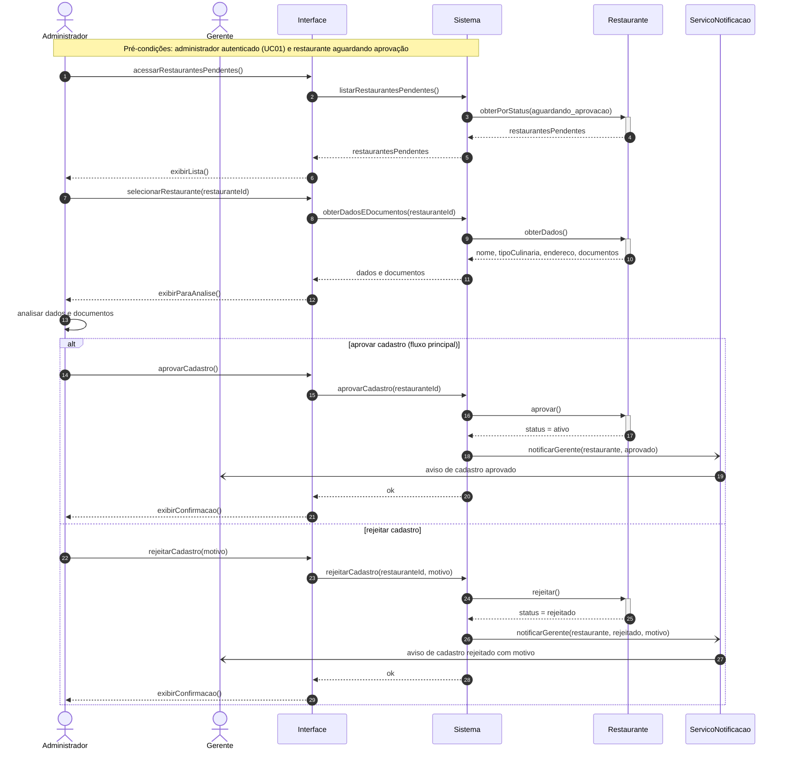

# Diagrama de Sequência 3 — Aprovar cadastro de restaurante (UC10)

## 1. Contexto

| Item | Descrição |
|---|---|
| **Caso de uso** | UC10 — Aprovar cadastro de restaurante |
| **Ator principal** | Administrador da Plataforma |
| **Pré-condições** | Administrador autenticado (UC01) e ao menos um restaurante com status `aguardando_aprovacao` (cadastrado no UC07) |
| **Pós-condição** | Restaurante `ativo` (pode receber reservas) ou `rejeitado` (fora da plataforma) |
| **Fluxo alternativo coberto** | Rejeitar cadastro, informando o motivo |

## 2. Linhas de vida

| Linha de vida | Papel | Origem |
|---|---|---|
| `Administrador` | Ator | Ator do UC10 |
| `Gerente` | Ator secundário (recebe o resultado da análise) | Ator do UC07 |
| `Interface` | Fronteira (tela web) | Camada de apresentação |
| `Sistema` | Controlador que orquestra o caso de uso | Camada de controle |
| `Restaurante` | Classe de domínio | TG3 |
| `ServicoNotificacao` | Serviço de apoio (não é classe de domínio) | Infraestrutura |

## 3. Diagrama

## 4. Explicação

**Listagem e análise.** O administrador abre a lista de restaurantes pendentes. O `Sistema` consulta os restaurantes com `status = aguardando_aprovacao` (valor do enum `StatusRestaurante` do TG3). Ao selecionar um deles, o administrador vê os dados e os documentos enviados no cadastro e os analisa. Essa análise é uma ação do próprio ator, representada pela mensagem para si mesmo (`A->>A`).

**Aprovar (fluxo principal).** O `Restaurante` muda para `status = ativo`, o que o habilita a receber reservas (UC04). O gerente responsável é notificado de forma assíncrona.

**Rejeitar (fluxo alternativo).** O administrador informa o motivo. O `Restaurante` muda para `status = rejeitado` e não é ativado. O gerente recebe a notificação com o motivo.

## 5. Decisões de modelagem e pontos em aberto

- O motivo da rejeição é enviado na notificação ao gerente, mas **não é guardado** no objeto `Restaurante`, porque a classe `Restaurante` do TG3 não tem um atributo para isso (diferente de `Reserva`, que tem `motivoRecusa`). Se a equipe quiser guardar o histórico, basta acrescentar um atributo `motivoRejeicao` ao diagrama de classes.
- O gerente aparece como ator secundário porque é quem recebe o resultado, mas não interage com o sistema durante este fluxo.
