# Diagrama de Atividades 1 — Reservar mesa (UC04)

## 1. Contexto

| Item | Descrição |
|---|---|
| **Caso de uso** | UC04 — Reservar mesa |
| **Ator principal** | Cliente |
| **Pré-condições** | Cliente autenticado (UC01) e restaurante já localizado na busca (UC03) |
| **Pós-condição** | Reserva criada com status `pendente`, aguardando confirmação do restaurante (UC09) |
| **Fluxos alternativos cobertos** | Cliente não autenticado; sem disponibilidade no horário escolhido |

## 2. Partições (raias)

| Partição | Responsabilidade |
|---|---|
| `Cliente` | Escolhe o restaurante, informa os dados, confirma a reserva e decide se aceita outro horário |
| `Sistema` | Verifica a sessão, consulta mesas, cria a reserva, notifica o restaurante e sugere horários |

## 3. Diagrama

```mermaid
flowchart TB
    classDef inicio fill:#000,stroke:#000
    classDef fim fill:#fff,stroke:#000,stroke-width:4px
    classDef barra fill:#000,stroke:#000,color:#000

    ini((" ")):::inicio
    fim(((" "))):::fim

    subgraph CLI ["Cliente"]
        c1["Selecionar restaurante"]
        c2["Informar data, horário e nº de pessoas"]
        c3["Revisar resumo e confirmar reserva"]
        d3{"Escolhe outro horário?"}
    end

    subgraph SIS ["Sistema"]
        d0{"Sessão válida?"}
        s0[["Autenticar-se (UC01)"]]
        s1["Consultar mesas disponíveis"]
        d1{"Há mesa disponível?"}
        s2["Exibir resumo da reserva"]
        s3["Criar reserva com status pendente"]
        f1[" "]:::barra
        s4["Notificar restaurante"]
        s5["Exibir confirmação (status pendente)"]
        j1[" "]:::barra
        s6["Sugerir horários próximos"]
        s7["Exibir horários sugeridos"]
    end

    ini --> d0
    d0 -->|"[não]"| s0
    s0 --> c1
    d0 -->|"[sim]"| c1
    c1 --> c2
    c2 --> s1
    s1 --> d1

    d1 -->|"[sim]"| s2
    s2 --> c3
    c3 --> s3
    s3 --> f1
    f1 --> s4
    f1 --> s5
    s4 --> j1
    s5 --> j1
    j1 --> fim

    d1 -->|"[não]"| s6
    s6 --> s7
    s7 --> d3
    d3 -->|"[sim]"| c2
    d3 -->|"[não]"| fim
```

**Legenda (UML):** círculo preenchido = nó inicial; círculo com borda grossa = nó final; losango = decisão; barra preta = bifurcação (*fork*) e junção (*join*); retângulo com bordas duplas = ação que invoca outra atividade (*call behavior*); as caixas `Cliente` e `Sistema` são as partições. O Mermaid não tem raias nativas, por isso elas foram desenhadas como agrupamentos.

## 4. Explicação

**Verificação da sessão.** A atividade começa com o sistema verificando se há sessão válida. Se não houver, é invocada a atividade de autenticação (UC01), detalhada em outro caso de uso e por isso mostrada só como referência. Depois do login, o fluxo segue normalmente.

**Escolha e consulta.** O cliente seleciona o restaurante e informa data, horário e número de pessoas. O sistema consulta as mesas disponíveis e chega a uma decisão: há ou não mesa para aquele pedido.

**Com disponibilidade (fluxo principal).** O sistema exibe o resumo, o cliente confirma e o sistema cria a reserva com `status = pendente`. Em seguida há uma bifurcação: o restaurante é notificado **em paralelo** com a exibição da confirmação ao cliente, pois uma ação não depende da outra. As duas se juntam antes do fim da atividade.

**Sem disponibilidade (fluxo alternativo).** O sistema sugere horários próximos e os exibe. Se o cliente aceitar algum, volta ao passo de informar os dados, e a consulta é refeita. Se não aceitar, a atividade termina sem criar reserva.

## 5. Decisões de modelagem e pontos em aberto

- O laço do cliente que escolhe outro horário volta para "Informar data, horário e nº de pessoas" (e não para o resumo), porque a disponibilidade precisa ser consultada de novo para o horário novo.
- A notificação ao restaurante e a exibição da confirmação estão em paralelo para ser coerente com o diagrama de sequência do TG4, em que a notificação é assíncrona.
- A especificação não prevê que o cliente desista na tela de resumo. Por isso não há decisão "confirma?" nesse ponto; a confirmação é tratada como ação certa do fluxo principal.
