# Diagrama de Atividades 2 — Gerenciar reservas recebidas (UC09)

## 1. Contexto

| Item | Descrição |
|---|---|
| **Caso de uso** | UC09 — Gerenciar reservas recebidas |
| **Ator principal** | Gerente do Restaurante |
| **Ator secundário** | Cliente (recebe notificações e responde à proposta de reagendamento) |
| **Pré-condições** | Gerente autenticado (UC01) e existência de reservas pendentes (UC04) |
| **Pós-condição** | Reserva com status definido (`confirmada`, `recusada` ou `reagendada`) e cliente notificado |
| **Fluxos alternativos cobertos** | Recusar reserva (com motivo); propor reagendamento |

## 2. Partições (raias)

| Partição | Responsabilidade |
|---|---|
| `Gerente` | Escolhe a reserva e decide: confirmar, recusar ou propor reagendamento |
| `Sistema` | Lista reservas, atualiza status, cria a proposta e envia notificações |
| `Cliente` | Analisa e responde à proposta de reagendamento |

## 3. Diagrama

```mermaid
flowchart TB
    classDef inicio fill:#000,stroke:#000
    classDef fim fill:#fff,stroke:#000,stroke-width:4px
    classDef barra fill:#000,stroke:#000,color:#000

    ini((" ")):::inicio
    fim(((" "))):::fim

    subgraph GER ["Gerente"]
        g1["Selecionar reserva pendente"]
        g2{"Decisão do gerente"}
        g3["Informar motivo da recusa"]
        g4["Informar nova data e horário"]
    end

    subgraph SIS ["Sistema"]
        s1["Listar reservas pendentes do restaurante"]
        s2["Exibir detalhes da reserva"]

        s3["Alterar reserva para confirmada"]
        fa[" "]:::barra
        s4["Notificar cliente: reserva confirmada"]
        s5["Exibir confirmação ao gerente"]
        ja[" "]:::barra

        s6["Alterar reserva para recusada e registrar motivo"]
        fb[" "]:::barra
        s7["Notificar cliente: reserva recusada, com motivo"]
        s8["Exibir confirmação ao gerente"]
        jb[" "]:::barra

        s9["Criar proposta de reagendamento (pendente)"]
        fc[" "]:::barra
        s10["Notificar cliente: proposta de novo horário"]
        s11["Exibir confirmação ao gerente"]
        jc[" "]:::barra

        s12["Marcar proposta como aceita"]
        s13["Reagendar reserva (nova data e horário)"]
        s14["Notificar gerente: reserva reagendada"]
        s15["Marcar proposta como recusada"]
        s16["Notificar gerente: proposta recusada"]
    end

    subgraph CLI ["Cliente"]
        c1["Analisar proposta de reagendamento"]
        c2{"Cliente aceita?"}
    end

    ini --> s1
    s1 --> g1
    g1 --> s2
    s2 --> g2

    g2 -->|"[confirmar]"| s3
    s3 --> fa
    fa --> s4
    fa --> s5
    s4 --> ja
    s5 --> ja
    ja --> fim

    g2 -->|"[recusar]"| g3
    g3 --> s6
    s6 --> fb
    fb --> s7
    fb --> s8
    s7 --> jb
    s8 --> jb
    jb --> fim

    g2 -->|"[propor reagendamento]"| g4
    g4 --> s9
    s9 --> fc
    fc --> s10
    fc --> s11
    s10 --> jc
    s11 --> jc
    jc --> c1
    c1 --> c2

    c2 -->|"[sim]"| s12
    s12 --> s13
    s13 --> s14
    s14 --> fim

    c2 -->|"[não]"| s15
    s15 --> s16
    s16 --> fim
```

**Legenda (UML):** círculo preenchido = nó inicial; círculo com borda grossa = nó final; losango = decisão; barra preta = bifurcação (*fork*) e junção (*join*). As caixas `Gerente`, `Sistema` e `Cliente` são as partições (desenhadas como agrupamentos, pois o Mermaid não tem raias nativas).

## 4. Explicação

**Parte comum.** O sistema lista as reservas pendentes do restaurante, o gerente escolhe uma e o sistema exibe os detalhes. Depois disso, o gerente toma uma decisão com três saídas.

**Confirmar (fluxo principal).** O sistema altera a reserva para `confirmada`. A notificação ao cliente e a confirmação na tela do gerente acontecem em paralelo (bifurcação/junção) e, depois da junção, a atividade termina.

**Recusar (fluxo alternativo).** O gerente informa o motivo, o sistema altera a reserva para `recusada` e registra o motivo (atributo `motivoRecusa`). O cliente é notificado com o motivo, em paralelo com a confirmação ao gerente.

**Propor reagendamento (fluxo alternativo).** O gerente informa nova data e horário e o sistema cria uma proposta com status `pendente`. A reserva ainda **não** muda. O cliente é notificado e analisa a proposta:

- se **aceita**, o sistema marca a proposta como aceita, reagenda a reserva (nova data e horário, status `reagendada`) e avisa o gerente;
- se **recusa**, o sistema marca a proposta como recusada e avisa o gerente.

## 5. Decisões de modelagem e pontos em aberto

- Cada desfecho tem sua própria bifurcação e junção, porque as notificações são assíncronas e independem da exibição da confirmação, como no diagrama de sequência do TG4.
- A resposta do cliente à proposta pode acontecer depois, em outra sessão. No diagrama ela aparece em sequência para manter a leitura simples; na prática, é um ponto de espera.
- **Ponto em aberto (herdado do UC09):** a especificação não diz o que acontece com a reserva se o cliente recusar a proposta. Seguindo o diagrama de estado, ela continua `pendente`, e só a proposta muda para `recusada`.
- **Ponto em aberto:** não há regra de prazo para o cliente responder. Se a equipe quiser, pode ser uma evolução (por exemplo, a proposta expirar).
