# Diagrama de Atividades 3 — Aprovar cadastro de restaurante (UC10)

## 1. Contexto

| Item | Descrição |
|---|---|
| **Caso de uso** | UC10 — Aprovar cadastro de restaurante |
| **Ator principal** | Administrador da Plataforma |
| **Ator secundário** | Gerente (recebe o resultado da análise) |
| **Pré-condições** | Administrador autenticado (UC01) e ao menos um restaurante com status `aguardando_aprovacao` (cadastrado no UC07) |
| **Pós-condição** | Restaurante `ativo` (pode receber reservas) ou `rejeitado` (fora da plataforma) |
| **Fluxo alternativo coberto** | Rejeitar cadastro, informando o motivo |

## 2. Partições (raias)

| Partição | Responsabilidade |
|---|---|
| `Administrador` | Seleciona e analisa o cadastro, decide aprovar ou rejeitar e informa o motivo da rejeição |
| `Sistema` | Lista pendentes, exibe dados e documentos, altera o status e notifica |
| `Gerente` | Recebe o aviso com o resultado da análise |

## 3. Diagrama

```mermaid
flowchart TB
    classDef inicio fill:#000,stroke:#000
    classDef fim fill:#fff,stroke:#000,stroke-width:4px
    classDef barra fill:#000,stroke:#000,color:#000

    ini((" ")):::inicio
    fim(((" "))):::fim

    subgraph ADM ["Administrador"]
        a1["Acessar restaurantes pendentes"]
        a2["Selecionar restaurante"]
        a3["Analisar dados e documentos"]
        a4{"Cadastro aprovado?"}
        a5["Informar motivo da rejeição"]
    end

    subgraph SIS ["Sistema"]
        s1["Listar restaurantes com status aguardando_aprovacao"]
        s2["Exibir dados e documentos"]

        s3["Alterar restaurante para ativo"]
        fa[" "]:::barra
        s4["Notificar gerente: cadastro aprovado"]
        s5["Exibir confirmação ao administrador"]
        ja[" "]:::barra

        s6["Alterar restaurante para rejeitado"]
        fb[" "]:::barra
        s7["Notificar gerente: cadastro rejeitado, com motivo"]
        s8["Exibir confirmação ao administrador"]
        jb[" "]:::barra
    end

    subgraph GER ["Gerente"]
        g1["Receber aviso de cadastro aprovado"]
        g2["Receber aviso de cadastro rejeitado"]
    end

    ini --> a1
    a1 --> s1
    s1 --> a2
    a2 --> s2
    s2 --> a3
    a3 --> a4

    a4 -->|"[sim]"| s3
    s3 --> fa
    fa --> s4
    fa --> s5
    s4 --> g1
    g1 --> ja
    s5 --> ja
    ja --> fim

    a4 -->|"[não]"| a5
    a5 --> s6
    s6 --> fb
    fb --> s7
    fb --> s8
    s7 --> g2
    g2 --> jb
    s8 --> jb
    jb --> fim
```

**Legenda (UML):** círculo preenchido = nó inicial; círculo com borda grossa = nó final; losango = decisão; barra preta = bifurcação (*fork*) e junção (*join*). As caixas `Administrador`, `Sistema` e `Gerente` são as partições (desenhadas como agrupamentos, pois o Mermaid não tem raias nativas).

## 4. Explicação

**Listagem e análise.** O administrador acessa a lista de restaurantes pendentes. O sistema traz os que estão com `status = aguardando_aprovacao`. Ao selecionar um, o administrador vê os dados e documentos enviados no cadastro e os analisa. A análise é uma ação do próprio administrador e leva à decisão "cadastro aprovado?".

**Aprovar (fluxo principal).** O sistema altera o restaurante para `ativo`, o que o habilita a receber reservas (UC04). Em paralelo, o gerente é notificado e o administrador vê a confirmação. As duas ações se juntam antes do fim da atividade.

**Rejeitar (fluxo alternativo).** O administrador informa o motivo, o sistema altera o restaurante para `rejeitado` e notifica o gerente com o motivo, também em paralelo com a confirmação na tela do administrador.

## 5. Decisões de modelagem e pontos em aberto

- O gerente aparece como partição porque é quem recebe o resultado, mas não age sobre o sistema neste fluxo; por isso só há ações de recebimento do aviso.
- Como no diagrama de sequência do TG4, o motivo da rejeição vai na notificação, mas **não é guardado** no objeto `Restaurante`, pois a classe do TG3 não tem atributo para isso. Se a equipe quiser guardar o histórico, basta acrescentar `motivoRejeicao` ao diagrama de classes.
- A especificação não prevê que o gerente reenvie o cadastro depois de rejeitado; por isso o estado `rejeitado` é tratado como o fim do fluxo.
