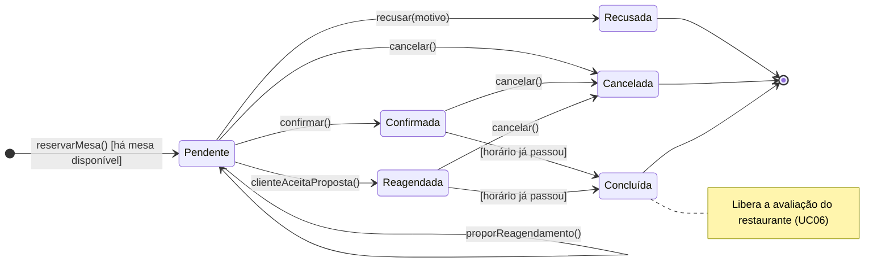

# Diagrama de Transição de Estado — Ciclo de vida da Reserva

## 1. Visão escolhida

| Item | Descrição |
|---|---|
| **Objeto modelado** | `Reserva` (classe de domínio do TG3) |
| **Atributo que guarda o estado** | `Reserva.status`, do tipo `StatusReserva` |
| **Casos de uso envolvidos** | UC04 (reservar mesa), UC05 (cancelar reserva), UC06 (avaliar restaurante), UC09 (gerenciar reservas recebidas) |
| **Atores que provocam transições** | Cliente e Gerente do Restaurante (e o passar do tempo) |

**Por que a Reserva?** Ela é o objeto central do sistema: nasce de uma ação do cliente, é decidida pelo gerente, pode ser desfeita pelo cliente e, no fim, habilita a avaliação do restaurante. É a classe do TG3 com mais estados (`pendente`, `confirmada`, `recusada`, `cancelada`, `reagendada`) e é onde as regras de negócio dos quatro casos de uso se encontram.

## 2. Diagrama

Caso o GitLab não renderize o bloco acima, a mesma figura está em [`diagrama-de-estado.png`](diagrama-de-estado.png).

## 3. Estados

| Estado | Valor em `StatusReserva` (TG3) | Significado |
|---|---|---|
| **Pendente** | `pendente` | Reserva criada pelo cliente, aguardando decisão do gerente. |
| **Confirmada** | `confirmada` | O gerente aceitou a reserva. A mesa está garantida para aquele horário. |
| **Reagendada** | `reagendada` | O gerente propôs outro horário e o cliente aceitou. A reserva passa a valer na nova data e no novo horário. |
| **Recusada** | `recusada` | O gerente recusou, informando um motivo. Estado final. |
| **Cancelada** | `cancelada` | O cliente desistiu. A mesa volta a ficar disponível. Estado final. |
| **Concluída** | *(não existe no TG3)* | A data e o horário já passaram com a reserva válida (mesa utilizada). Estado final. |

**Estado inicial:** a Reserva só passa a existir quando o cliente confirma os dados no UC04, e já nasce `Pendente`. **Estados finais:** `Recusada`, `Cancelada` e `Concluída`.

## 4. Transições

Formato usado nos rótulos: `evento [condição de guarda] / ação`.

| # | Origem | Destino | Evento | Guarda | Ação | Origem na especificação |
|---|---|---|---|---|---|---|
| 1 | *(início)* | Pendente | `reservarMesa()` | há mesa disponível para data, horário e nº de pessoas | `notificarRestaurante()` | UC04, passos 2 a 4 |
| 2 | Pendente | Confirmada | `confirmar()` | — | `notificarCliente()` | UC09, fluxo principal |
| 3 | Pendente | Recusada | `recusar(motivo)` | motivo informado | `registrarMotivo()`, `notificarCliente()` | UC09, fluxo alternativo |
| 4 | Pendente | Pendente | `proporReagendamento(novaData, novoHorario)` | — | `criarProposta()`, `notificarCliente()` | UC09, fluxo alternativo |
| 5 | Pendente | Reagendada | `clienteAceitaProposta()` | existe proposta pendente | `atualizarDataEHorario()`, `notificarGerente()` | UC09, pós-condição |
| 6 | Pendente, Confirmada ou Reagendada | Cancelada | `cancelar()` | — | `liberarMesa()`, `notificarRestaurante()` | UC05 |
| 7 | Confirmada | Concluída | *(passagem do tempo)* | data e horário já passaram | — | UC06, pré-condição |
| 8 | Reagendada | Concluída | *(passagem do tempo)* | data e horário já passaram | — | UC06, pré-condição |

## 5. Explicação

**Nascimento e decisão do gerente.** A reserva entra no sistema como `Pendente` e fica assim até o gerente agir (UC09). Dali ela pode seguir por três caminhos: ser **confirmada**, ser **recusada** (com motivo, que fica gravado no atributo `motivoRecusa` do TG3) ou receber uma **proposta de reagendamento**.

**Reagendamento.** Quando o gerente propõe outro horário, a reserva continua `Pendente`: o que muda é que passa a existir um objeto `PropostaReagendamento` com status `pendente` (transição 4, desenhada como laço no próprio estado `Pendente`). A reserva só vira `Reagendada` quando o cliente aceita a proposta (transição 5), e aí a data e o horário da reserva são atualizados. Isso é coerente com o diagrama de sequência do TG4, em que a proposta tem o próprio ciclo de vida.

**Cancelamento.** O cliente pode cancelar enquanto a reserva estiver ativa, isto é, `Pendente`, `Confirmada` ou `Reagendada`. Por isso a transição 6 aparece no diagrama partindo dos três estados. Ao cancelar, a mesa é liberada para outros clientes. O UC05 diz que, fora do prazo da política do restaurante, o sistema apenas **informa** a política antes de confirmar. Por isso não colocamos essa regra como guarda: o cancelamento continua possível.

**Conclusão.** Quando a data e o horário passam, uma reserva `Confirmada` ou `Reagendada` vira `Concluída`. Esse é o estado que o UC06 exige para o cliente poder avaliar o restaurante ("reserva já concluída"). Uma reserva `Pendente` não chega a esse estado, pois nunca foi aceita pelo restaurante.

## 6. Pontos em aberto e decisões da equipe

- **`Concluída` não existe no enum `StatusReserva` do TG3.** O UC06 depende desse estado, então ele entrou no diagrama. Para manter os entregáveis consistentes, a sugestão é acrescentar o valor `concluida` ao enum no diagrama de classes.
- **O que acontece depois de `Reagendada`?** A especificação não diz se o gerente precisa confirmar de novo. Assumimos que não: a proposta partiu do próprio gerente e o cliente aceitou, então `Reagendada` equivale a uma reserva firme (por isso ela pode ir para `Concluída` e ser cancelada).
- **Cliente recusa a proposta de reagendamento.** A especificação também não cobre esse caso. No diagrama, a reserva simplesmente continua `Pendente`, com a proposta marcada como `recusada` no objeto `PropostaReagendamento`.
- **Reserva `Pendente` que ninguém responde.** Não há regra de expiração na especificação, então não inventamos um estado `Expirada`. Se a equipe quiser, é um bom candidato a evolução.
